<p align="center">
  
</p>

# 🛡️ Awesome-Security-Compliance-Portal

<p align="center">
  <a href="https://github.com/ishandutta2007/Awesome-Awesome-Awesome"></a><a href="https://discord.gg/jc4xtF58Ve"></a>
  <a href="https://github.com/ishandutta2007/Awesome-Security-Compliance-Portal"></a>
  <a href="https://opensource.org/licenses/MIT"></a>
  <a href="https://github.com/ishandutta2007"></a>
</p>

## 🌐 Top Security & Compliance Portal Ecosystem

> **Curated List of SaaS Products & Open-Source GitHub Projects for Trust Center Publishing, Continuous Compliance Automation, and Self-Hosted GRC Portals.**

📅 **Last updated: October 2026**

This repository tracks notable **SaaS platforms** and **open-source projects** for **Security & Compliance Portals**. These systems empower organizations to publish customer-facing Trust Centers showcasing security posture, real-time control health, compliance certifications (SOC 2, ISO 27001, HIPAA, GDPR, NIST), and authorized subprocessors—while streamlining internal GRC workflows, continuous evidence collection, and automated vendor risk questionnaires.

---

## 📑 Table of Contents

- [📊 Sector Overview & Market Dynamics](#-sector-overview--market-dynamics)
- [☁️ SaaS/Hosted Platforms](#️-saashosted-platforms)
- [💻 Open-Source GitHub Projects](#-open-source-github-projects)
  - [🌐 Public Trust Centers (Standalone)](#-public-trust-centers-standalone)
  - [🏢 Comprehensive GRC Platforms with Trust/Compliance Portals](#-comprehensive-grc-platforms-with-trustcompliance-portals)
  - [🤖 Compliance Automation & AI Governance Tools](#-compliance-automation--ai-governance-tools)
- [🏗️ Frameworks & Architecture Considerations](#️-frameworks--architecture-considerations)
- [📈 Star History](#-star-history)
- [💖 Support & Community](#-support--community)
- [🤝 How to Contribute](#-how-to-contribute)
- [⚖️ Disclaimer & License](#️-disclaimer--license)

---

## 📊 Sector Overview & Market Dynamics

The global Governance, Risk, and Compliance (GRC) and Security Compliance Automation market is estimated at **$45.3B–$60.5B in 2026** (with the dedicated IT-GRC and continuous compliance sub-segment exceeding **$22.6B**) and is projected to expand past **$80B–$116B by 2030** at an 11–13% CAGR. The sector exhibits **moderate fragmentation with aggressive category convergence**: while hyperscale enterprise incumbents (Atlassian, OneTrust) anchor multi-pillar suites, high-velocity compliance unicorns (Vanta, Drata) and customer trust automation specialists (SafeBase, Conveyor) compete fiercely in a rapidly consolidating landscape where buyer security reviews and AI-assisted questionnaire handling have turned compliance from a passive cost center into a core revenue-acceleration driver.

---

## ☁️ SaaS/Hosted Platforms

The table below lists leading commercial Security & Compliance Portal solutions, sorted by **Company Scale / Valuation (descending)**:

| Platform | Category / Focus | Starting Tier Pricing | Free Tier / Free Trial Limits | Company Scale / Valuation |
| :--- | :--- | :--- | :--- | :--- |
| **[Atlassian Trust Center](https://www.atlassian.com/)** | 🏢 Enterprise Trust Portal & Security Governance | **Free** public Trust Center; [Atlassian Guard](https://www.atlassian.com/software/guard) starts at **$4.00/user/mo** | **Free forever** for public Trust Center; 30-day free trial for Atlassian Guard security add-on | Public (NASDAQ: TEAM) ~$50B Market Cap / $6.57B Annual Revenue |
| **[OneTrust](https://www.onetrust.com/)** | 🔐 Enterprise Privacy, Security & Third-Party GRC Suite | **$10,000/year** entry minimum (~$800–$1,100/mo billed annually for baseline modules) | **No free tier**; No self-serve trial (custom enterprise proof-of-concept upon sales approval) | Private ~$4.5B Valuation / ~$550M ARR |
| **[Vanta Trust Center](https://www.vanta.com/)** | 🚀 Continuous Compliance Automation & Trust Management | **$14,000/year** (Essentials tier for 1–20 seats, billed annually) | **No free tier**; No self-serve trial (guided sales demo and custom enterprise POC only) | Private ~$4.2B Valuation / >$300M ARR |
| **[Drata Trust Center](https://drata.com/)** | 🛡️ Automated Audit Readiness, Continuous GRC & Trust Portals | **$7,500/year** (Starter tier for early startups, billed annually) | **No free tier**; No self-serve trial (sandbox demo granted post sales consultation) | Private ~$2.0B Valuation / >$100M ARR |
| **[SafeBase](https://safebase.io/)** | 🌐 Customer Trust Center & Security Questionnaire Automation | **$0/mo** (Foundation); Paid tiers start from **~$6,000–$10,000/year** | **Free forever plan** capped at 25 approved domains and basic Trust Center publishing | Acquired by Drata (~$250M Acquisition Value) / ~$10.3M ARR |
| **[Secureframe Trust Center](https://secureframe.com/)** | 🔒 Automated SOC 2/ISO 27001 Compliance & Trust Sharing | **$7,500/year** (Fundamentals tier, billed annually) | **No free tier**; No self-serve trial (scheduled product demo with account team) | Private ~$200M–$500M Est. Valuation / ~$20M+ ARR ($79M Raised) |
| **[Whistic](https://www.whistic.com/)** | 📋 Dual-Sided Vendor Security Network & Trust Catalog | **$0/mo** (Basic Profile); Paid enterprise tiers start at **$15,000/year** | **Free forever Basic Profile** with 1 user, 1 profile, and up to 3 proactive profile shares/month | Private ~$100M–$250M Est. Valuation / ~$10M–$17M Revenue ($51M Raised) |
| **[Conveyor](https://conveyor.com/)** | 🤖 AI-Native Customer Trust Center & Security Reviews | **$9,600/year** ($800/mo billed annually for Business Plan) | **Free forever plan** limited to 15 documents, 10 Trust Center portal credits/mo (no AI review agent) | Private ~$80M–$100M Est. Valuation / ~$40M Total Raised |
| **[TrustCloud](https://trustcloud.ai/)** | ⚡ AI-Native Predictive Compliance & Programmatic TrustShare | **$1,999/year** (~$400/mo billed annually for starter compliance) | **Free forever plan** for startups (<20 employees) with basic SOC 2 readiness and TrustShare portal | Private ~$50M–$100M Est. Valuation / $1M–$10M Revenue ($52M Raised) |
| **[RegScale](https://regscale.com/)** | ⚙️ Continuous Controls Monitoring (CCM) & Compliance-as-Code | **$0/mo** (Community Edition); Enterprise Edition custom quote (~$20,000+/year) | **Free forever Community Edition** (self-hosted CLI/OSCAL tool; excludes enterprise automation cluster) | Private Growth Stage ($60M Total Raised, M12/Microsoft backed) |

---

## 💻 Open-Source GitHub Projects

The table below catalogs self-hostable open-source trust portals, GRC automation engines, and compliance-as-code suites, sorted by **GitHub Stars (descending)**. Every project includes its live social star counter linking to its repository stargazers page:

| Project | Stars | Primary Focus / Description | Tech Stack & License |
| :--- | :--- | :--- | :--- |
| **[CISO Assistant](https://github.com/intuitem/ciso-assistant-community)** | [](https://github.com/intuitem/ciso-assistant-community/stargazers) | 🛡️ All-in-one open-source GRC platform covering Risk Management, AppSec, Audit, TPRM, BIA, and Privacy. Supports 200+ global frameworks (ISO 27001, NIST CSF, SOC 2, NIS2, GDPR, HIPAA) with community trust portal add-ons. | Python, Django, React, Docker<br>`AGPL-3.0` |
| **[StrongDM Comply](https://github.com/strongdm/comply)** | [](https://github.com/strongdm/comply/stargazers) | 📜 Developer-centric compliance automation framework focused on SOC 2. Treats policies and procedures as code, automating audit evidence collection and generating compliance documentation from Markdown. | Go, CLI, Pandoc<br>`Apache-2.0` |
| **[Probo](https://github.com/getprobo/probo)** | [](https://github.com/getprobo/probo/stargazers) | ⚡ Modern AI-native open-source GRC platform with integrated public compliance pages. Features NDA gating, risk register, vendor risk, 270+ MCP tools for AI agents, and a dedicated `prb` CLI. | Go, TypeScript, React, GraphQL<br>`ISC` |
| **[VerifyWise](https://github.com/verifywise-ai/verifywise)** | [](https://github.com/verifywise-ai/verifywise/stargazers) | 🤖 Open-source AI governance, risk evaluation, and compliance platform. Enables cross-mapping and auditing against the EU AI Act, ISO/IEC 42001, and NIST AI RMF with CI/CD PR gating. | Python, FastAPI, Next.js<br>`Apache-2.0` |
| **[Openlane](https://github.com/theopenlane/core)** | [](https://github.com/theopenlane/core/stargazers) | 🏢 Enterprise-grade open-source compliance automation engine for SOC 2, ISO 27001, GDPR, and NIST 800-53. Ships with native SSO/2FA on every tier; Trust Center portal module actively being integrated. | Go, Ent, GraphQL, OpenFGA<br>`Apache-2.0` |
| **[GigaChad GRC](https://github.com/grcengineering/gigachad-grc)** | [](https://github.com/grcengineering/gigachad-grc/stargazers) | 🚀 Streamlined, containerized open-source GRC platform for engineering teams. Automates SOC 2, ISO 27001, and HIPAA control checks, vendor assessments, and internal audit logs with AI copilot integration. | TypeScript, Node.js, Docker<br>`Apache-2.0` |
| **[OpenGRC](https://github.com/LeeMangold/OpenGRC)** | [](https://github.com/LeeMangold/OpenGRC/stargazers) | 🗂️ Self-hosted GRC platform tailored for small and mid-sized security teams. Centralizes risk management, security controls, audit readiness, and incident handling for NIST CSF, HIPAA, and ISO 27001. | PHP, JavaScript, Docker<br>`GPL-3.0` |
| **[Unicis Platform CE](https://github.com/UnicisTech/unicis-platform-ce)** | [](https://github.com/UnicisTech/unicis-platform-ce/stargazers) | 🔍 Self-hosted, all-in-one compliance and risk management portal. Serves as a transparent open-source alternative to Vanta/Drata for tracking ISO 27001, GDPR, and NIS2 evidence without SaaS lock-in. | TypeScript, React, Node.js<br>`AGPL-3.0` |
| **[Kodus Trust Center](https://github.com/kodustech/trust-center)** | [](https://github.com/kodustech/trust-center/stargazers) | 🌐 Purpose-built standalone open-source Trust Center. Renders a public-facing security trust portal from a single YAML configuration file with compliance badges, subprocessor lists, and document requests. | Next.js 16, Supabase, Tailwind CSS<br>`MIT` |
| **[QuickTrust](https://github.com/allgpt-co/quicktrustfinal)** | [](https://github.com/allgpt-co/quicktrustfinal/stargazers) | 🤖 AI-agent-first open-source GRC framework. Features an automated SOC 2 Type II seed library, compliance scoring dashboard, and Bedrock/Claude agent for tailoring internal security controls. | Python, React, Bedrock<br>`AGPL-3.0` |

---

### 🌐 Public Trust Centers (Standalone)

- **[Kodus Trust Center](https://github.com/kodustech/trust-center)**: The most dedicated standalone open-source **Trust Center builder**. Built with Next.js 16 and Supabase, it generates a full public-facing trust site directly from a YAML document. Includes compliance badges, subprocessor inventories, NDA-governed document requests, FAQ accordions, and an admin UI.

---

### 🏢 Comprehensive GRC Platforms with Trust/Compliance Portals

- **[CISO Assistant](https://github.com/intuitem/ciso-assistant-community)**: The most widely adopted open-source GRC platform. Offers a centralized hub for multi-framework compliance mapping, risk scoring, vendor reviews, and community-driven trust portal integration.
- **[Probo](https://github.com/getprobo/probo)**: Full-lifecycle open-source GRC platform offering out-of-the-box public compliance pages with custom domain support and NDA document gating. Highly agentic with 270+ MCP endpoints.
- **[Unicis Platform CE](https://github.com/UnicisTech/unicis-platform-ce)**: Comprehensive community platform for privacy, vendor risk, and compliance tracking without recurring enterprise software fees.
- **[OpenGRC](https://github.com/LeeMangold/OpenGRC)**: Lightweight, modular self-hosted risk and audit management system for SMB security operations.
- **[GigaChad GRC](https://github.com/grcengineering/gigachad-grc)**: Developer-first GRC system containerized for rapid deployment with modern control tracking.

---

### 🤖 Compliance Automation & AI Governance Tools

- **[StrongDM Comply](https://github.com/strongdm/comply)**: Markdown/Git-based compliance-as-code automation tool for SOC 2 policies, evidence, and audit prep.
- **[Openlane](https://github.com/theopenlane/core)**: Enterprise compliance automation engine written in Go with OpenFGA authorization, built to replace commercial compliance automation tools.
- **[VerifyWise](https://github.com/verifywise-ai/verifywise)**: Specialized open-source governance platform focusing on LLM evaluations and AI regulations (EU AI Act, ISO 42001, NIST AI RMF).
- **[QuickTrust](https://github.com/allgpt-co/quicktrustfinal)**: AI-native SOC 2 readiness engine using LLM agents to draft controls suited to your specific cloud stack.

---

## 🏗️ Frameworks & Architecture Considerations

Organizations adopting or building a security and compliance portal typically operate across two decoupled layers:

```
┌────────────────────────────────────────────────────────────────────────┐
│                   Layer 1: Public Customer Trust Center                │
│ (Certifications, Subprocessors, NDA-Gated Audit Reports, Security FAQs)│
├────────────────────────────────────────────────────────────────────────┤
│ Examples: Kodus Trust Center, SafeBase, Conveyor, Atlassian Portal     │
└────────────────────────────────────┬───────────────────────────────────┘
                                     │ Continuous Sync / Evidence
┌────────────────────────────────────▼───────────────────────────────────┐
│                 Layer 2: Internal GRC & Evidence Automation            │
│  (Cloud Posture Monitoring, Access Reviews, Control Testing, Risk)     │
├────────────────────────────────────────────────────────────────────────┤
│ Examples: CISO Assistant, Probo, Openlane, Vanta, Drata, OneTrust      │
└────────────────────────────────────────────────────────────────────────┘
```

1. 🎯 **Standalone Trust Center vs. Integrated GRC**: If you already maintain internal GRC controls, deploying a lightweight, YAML-driven portal like **Kodus Trust Center** provides instant buyer transparency without platform lock-in. If you need end-to-end evidence collection with a public badge, evaluate **Probo** or **CISO Assistant**.
2. 🤖 **AI & Questionnaires**: SafeBase and Conveyor dominate automated questionnaire answering for enterprise sales teams. In open-source setups, **Probo's 270+ MCP tools** allow teams to wire local LLMs directly into control registers to answer security inquiries programmatically.

---

## 📈 Star History

[](https://star-history.dera.page/#ishandutta2007/Awesome-Security-Compliance-Portal&type=date&legend=top-left)

---

## 💖 Support & Community

Thank you for visiting and supporting the **Awesome Security Compliance Portal** project! 🌟

If you find this curated collection helpful for your security operations, compliance journey, or vendor risk management, please consider:
- ⭐ **Starring this repository** on GitHub to help others discover it.
- 🍴 **Forking and sharing** with your InfoSec, DevOps, and GRC peers.
- 💬 **Joining the conversation** on [Discord](https://discord.gg/jc4xtF58Ve) to share your security portal setups and insights.
- ☕ **Supporting the creator**: If you would like to support ongoing research and curation across open-source compliance tools, feel free to [buy me a coffee via the GitHub Sponsor Dashboard](https://github.com/sponsors/ishandutta2007)!

<p align="center">
  <a href="https://github.com/sponsors/ishandutta2007">
    
  </a>
</p>

---

## 🤝 How to Contribute

Contributions are warmly welcomed! Please follow these steps:

1. 🍴 Fork this repository.
2. 📝 Add or update entries following the established table formats (ensure specific pricing numbers, explicit free tier limits, company valuation/scale, and social star badges are included).
3. 🔗 Verify that URLs link directly to official project websites or GitHub repositories.
4. 🚀 Submit a Pull Request with a clear summary of your additions.

---

## ⚖️ Disclaimer & License

- ⚠️ This repository is a community-curated directory intended solely for educational, architectural, and informational purposes.
- 🏷️ All product names, logos, trademarks, and registered trademarks belong to their respective owners.
- 🛡️ Compliance and security claims published on Trust Centers carry regulatory and legal liability. Always verify audit reports with accredited certifying bodies (CPA firms, ISO registrars).
- 📄 Distributed under the [MIT License](file:///C:/Users/hp/Documents/Projects/Awesome-Security-Compliance-Portal/LICENSE).
